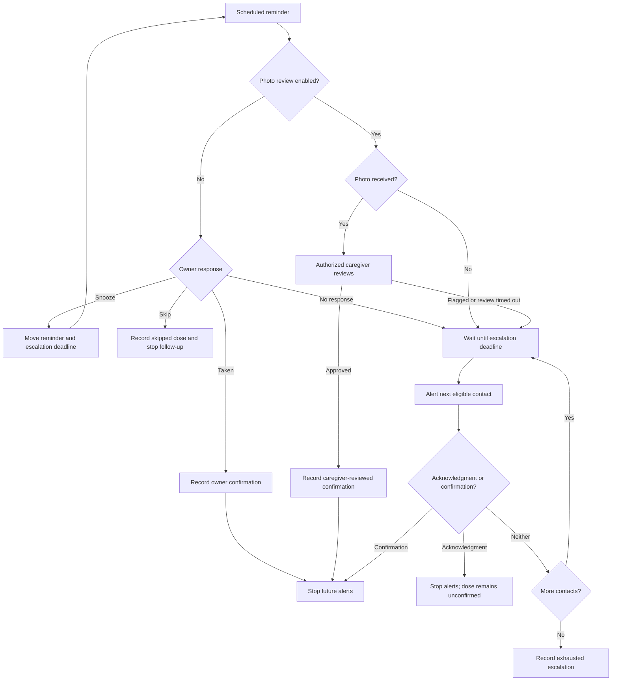
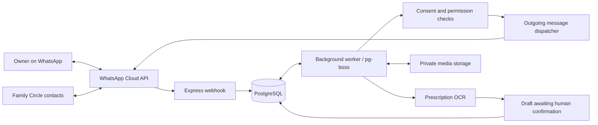

# Kinova.

**Medicine reminders and thoughtful family follow-up, inside WhatsApp.**

[](#project-status)
[](#proposed-tech-stack)
[](#license)

<!-- TODO: Add a CI badge after a workflow exists. -->
<!-- TODO: Replace the license badge after adding LICENSE. -->

Kinova is a planned WhatsApp companion that helps older adults manage medicine reminders, prescriptions, and bill due dates. When a dose remains unconfirmed, an owner-controlled **Family Circle** can receive alerts in a chosen order.

The older adult stays in control of their schedules, information, and who can help.

> **Project status:** Planning and documentation. The features and conversations below describe intended behavior, not a working application.
>
> Kinova is a reminder and coordination tool—not medical advice or an emergency monitoring service.

## Demo / Screenshots

<!-- TODO: Add a demo GIF after the first working flow is implemented. Use fictional data. Show an owner creating a reminder, confirming a dose, and a separate unconfirmed dose triggering a generic caregiver alert. -->

A demo will be added when the first complete reminder and family-alert flow works.

## The Problem

Managing medicine schedules, prescriptions, and bills can become difficult. Family members want to help but cannot always check in.

A separate app can introduce unfamiliar screens, downloads, and account setup. Kinova aims to put these interactions in WhatsApp while making family involvement optional and transparent.

## Our Approach

Start with a small, reliable flow:

1. The owner creates a medicine reminder.
2. Kinova sends the scheduled reminder.
3. The owner chooses **Taken**, **Snooze**, or **Skip**.
4. If the dose remains unconfirmed, Kinova alerts an authorized Family Circle member.
5. Confirmation or a caregiver acknowledgment stops further escalation for that dose.

Prescription extraction, bill reminders, and photo review will follow after this foundation is tested.

## Planned Features

| Feature | Intended behavior | Stage |
| --- | --- | --- |
| Owner-created reminders | Create, edit, pause, resume, and delete schedules through chat | MVP |
| Simple dose actions | Taken, Snooze, and Skip | MVP |
| Family Circle | Alert consenting contacts in an owner-defined order | MVP |
| Sharing levels | Control how much medicine information each member receives | MVP |
| Owner data controls | View, export, and delete personal records | MVP |
| Advanced schedules | Every-X-hours intervals, course dates, and as-needed records | Later |
| Delegated management | Explicitly allow a caregiver to manage schedules | Later |
| Prescription intake | Extract draft fields from text or photos, then require human confirmation | Later |
| Bill reminders | Track due dates and manually recorded payment status | Later |
| Caregiver photo review | Optional, per-medicine review by an authorized caregiver | Later |
| Automated image checks | Evaluate usefulness and limitations before implementation | Deferred |

No prescription extraction result will become an active medicine schedule without explicit confirmation.

## How Family Circle Escalation Works

The owner assigns each member a role, priority, and sharing level. Roles such as **Primary Caregiver**, **Nearest Relative**, or **Family Member** are labels; they do not automatically grant access.

The owner chooses the actual contact order. Kinova does not infer proximity or track contact locations.

### Example timeline

This example uses a 15-minute interval and assumes no snooze, confirmation, or acknowledgment.

| Time | Action |
| --- | --- |
| T+0 | Send the owner a medicine reminder |
| T+15 minutes | Alert the first eligible Family Circle member |
| T+30 minutes | Alert the next eligible member |
| T+45 minutes | Continue to the next member if the dose remains unresolved |
| On dose confirmation | Stop remaining escalation |
| On caregiver acknowledgment | Stop remaining escalation, but keep the dose unconfirmed |
| When contacts are exhausted | Record that no further contacts remain; do not imply emergency assistance |

A caregiver acknowledgment means **“I will check in.”** It does not mean the medicine was taken.



Queued alerts will be rechecked before dispatch. An alert already sent or in flight may still arrive after a confirmation.

## Photo Verification

**Planned, optional, and off by default.**

The owner will be able to enable photo review for an individual medicine, choose an authorized reviewer, and see who is allowed to receive the images.

### Review modes

| Mode | Status | Intended behavior |
| --- | --- | --- |
| Caregiver review | Planned | A designated caregiver approves or flags a photo |
| Automated check | Deferred | Requires evaluation before any capability or accuracy claims |

### Intended behavior

- **Approved photo:** Record the caregiver-reviewed confirmation and stop future escalation.
- **Missing photo:** Keep the dose unconfirmed and follow the escalation policy.
- **Flagged photo:** Keep the dose unconfirmed and continue appropriate follow-up.
- **Reviewer does not respond:** Keep the dose unconfirmed; do not let review stall escalation indefinitely.
- **Feature disabled:** Use the ordinary confirmation flow for subsequent doses.

For photo-enabled medicines, a plain “Taken” reply will not silently bypass the selected review requirement.

> A photo may show a pill or an empty blister slot. It does not prove that the medicine was swallowed, that the dose was correct, or that treatment instructions were followed.

Images received by a caregiver may remain on that person’s device. Kinova cannot promise to erase copies outside its own systems.

<!-- TODO: Finalize review deadlines, disable-feature behavior for pending doses, and retention settings before implementation. -->

## Data Ownership and Sharing

The older adult remains the owner of their medicines, schedules, dose records, prescriptions, and verification photos.

When an authorized caregiver enters a record on their behalf, the caregiver is recorded as its creator—not its owner.

### Sharing levels

| Level | Member can receive or view |
| --- | --- |
| **1 — Alerts only** | A generic alert such as “Maya has not confirmed a scheduled dose” |
| **2 — Medicine name** | Alerts that also identify the medicine |
| **3 — Full view** | Medicines, schedules, and dose history |

All members start at Level 1. Membership does not grant editing, exporting, deleting, or photo access.

**Photo permissions are separate from sharing levels.**

### Delegation

Delegation will be:

- Off by default.
- Explicitly granted by the owner.
- Limited to specified actions.
- Visible to the owner.
- Revocable at any time.

Revocation must block subsequent access, including attempts to save changes from an already-open conversation.

### Deletion

Deleting a medicine will remove it from application views, cancel its pending work, and initiate deletion of its logs and stored photos.

Backup expiry and copies already delivered through WhatsApp require separate handling. The privacy policy will explain these limits.

<!-- TODO: Publish the implemented deletion process and backup retention period. -->

## Example WhatsApp Conversations

These examples use fictional names and medicine labels. They are proposed interactions, not screenshots of a deployed bot.

<details>
<summary>1. Normal reminder</summary>

```text
Kinova: Maya, it is time for your 8:00 AM medicine.
        [Taken] [Snooze] [Skip]

Maya: Taken

Kinova: Recorded as taken for the 8:00 AM dose. Thank you.
```

</details>

<details>
<summary>2. Photo-reviewed dose</summary>

```text
Kinova: It is time for your scheduled medicine.
        You enabled photo review for this reminder.
        Please send a photo for Ravi to review.

Maya: [Sends photo]

Kinova: Your photo is waiting for Ravi's review.

Kinova → Ravi: Maya has sent a photo for an authorized review.
               [Approve] [Flag]

Ravi: Approve

Kinova → Maya: Ravi approved the photo.
               Further alerts for this dose are stopped.
```

Photo delivery will respect the reviewer’s permissions and WhatsApp messaging-window requirements.

</details>

<details>
<summary>3. Unconfirmed dose with family follow-up</summary>

```text
8:00 AM
Kinova → Maya: It is time for your scheduled medicine.
               [Taken] [Snooze] [Skip]

8:15 AM
Kinova → Ravi: Maya has not confirmed a scheduled dose.
               Can you check in?
               [I'll check in]

Ravi: I'll check in

Kinova → Ravi: Thank you. Further family alerts are stopped.
               The dose is still recorded as unconfirmed.
```

</details>

<details>
<summary>4. Owner creating a schedule</summary>

```text
Maya: Add medicine

Kinova: What is the medicine called?
Maya: Medicine A

Kinova: What dose is written on your prescription?
Maya: One tablet

Kinova: When should I remind you?
        [Every day] [Choose days]

Maya: Every day

Kinova: What time?
Maya: 8 AM

Kinova: Is your time zone Asia/Kolkata?
        [Yes] [Change]

Maya: Yes

... Kinova asks about meal instructions, snooze,
    contact order, escalation interval, and quiet hours ...

Kinova: Please check:
        Medicine A — one tablet
        Every day at 8:00 AM
        After breakfast
        Snooze: 10 minutes
        Family alerts: Ravi, then Leela
        Escalation interval: 15 minutes
        Photos: off
        [Save] [Change] [Cancel]
```

</details>

<details>
<summary>5. Level 1 alert</summary>

```text
Kinova → Leela: Maya has not confirmed a scheduled dose.
                Can you check in?
                [I'll check in]
```

No medicine name, dose, prescription, or photo is included.

</details>

## Proposed System Architecture



| Component | Responsibility |
| --- | --- |
| Webhook | Verify requests and persist incoming events |
| Conversation handlers | Guide users through one question at a time |
| PostgreSQL | Store owners, permissions, schedules, dose records, and message intents |
| pg-boss worker | Run persistent reminder, escalation, and cleanup jobs |
| Permission layer | Check current ownership, consent, sharing, and delegation |
| Message dispatcher | Send eligible messages and track provider responses |
| OCR adapter | Extract draft prescription text without activating schedules |
| Private media storage | Store authorized images with retention and deletion controls |

### Reliability principles

- Persist jobs so reminders survive process restarts.
- Deduplicate incoming events and outgoing message intents.
- Recheck permissions immediately before sending.
- Keep delivery status separate from dose confirmation.
- Invalidate stale work after schedule edits or deletion.
- Distinguish uncertain sends from confirmed delivery.
- Avoid sending a burst of overdue alerts after an outage.

These are implementation requirements, not guarantees already provided by the project.

## Proposed Tech Stack

| Layer | Selection |
| --- | --- |
| Language | TypeScript |
| Backend | Node.js + Express |
| WhatsApp | Official Meta WhatsApp Cloud API |
| Database | PostgreSQL |
| Database client | `pg` |
| Durable jobs | `pg-boss` |
| Input validation | Zod |
| Time zones | Luxon |
| Testing | Vitest + PostgreSQL integration tests |
| Prescription OCR | Amazon Textract, introduced later |
| Media storage | Private Amazon S3 bucket, introduced later |
| Hosting | Render web service, background worker, and managed PostgreSQL |

<!-- TODO: Pin supported runtime and dependency versions when application scaffolding is committed. -->

## Getting Started

### Current availability

This README describes the implementation plan. Application installation and execution commands will be added when the corresponding files exist.

### Prerequisites for development

- Git.
- A supported Node.js LTS release.
- npm.
- PostgreSQL, locally or through Docker.
- A Meta developer setup for WhatsApp testing.
- An HTTPS endpoint or development tunnel for webhooks.

AWS services are needed only when OCR and media features are introduced.

### Clone the repository

```bash
git clone https://github.com/SurenDotCode/Kinova.git
cd Kinova
```

<!-- TODO: Add verified dependency installation, migration, API startup, and worker startup commands after implementation. Do not document nonexistent npm scripts as working commands. -->

### Proposed environment variables

These names describe the planned configuration. They are not yet implemented.

| Variable | Purpose | Needed for |
| --- | --- | --- |
| `DATABASE_URL` | PostgreSQL connection string | Core application |
| `META_APP_SECRET` | Incoming webhook signature verification | WhatsApp integration |
| `META_GRAPH_VERSION` | Explicitly selected supported Graph API version | WhatsApp integration |
| `WHATSAPP_VERIFY_TOKEN` | Webhook setup challenge token | WhatsApp integration |
| `WHATSAPP_ACCESS_TOKEN` | Sending messages through Meta | WhatsApp integration |
| `WHATSAPP_PHONE_NUMBER_ID` | API sender identifier | WhatsApp integration |
| `AWS_REGION` | Region for configured AWS services | OCR/media |
| `S3_BUCKET` | Private media bucket name | Media storage |

Never commit access tokens, database credentials, or real health information.

<!-- TODO: Add .env.example, startup validation, and the selected AWS authentication mechanism. -->

### WhatsApp Business API setup

1. Create a Meta developer app and configure the WhatsApp product.
2. Use the provided development setup and eligible test recipients.
3. Configure the application’s HTTPS webhook URL.
4. Implement the verification challenge and signed POST validation.
5. Subscribe to the required message events.
6. Configure recipient consent and STOP handling.
7. Submit reminder and family-alert templates for approval.
8. Test inbound messages, replies, delivery updates, and failures.

Outside a recipient’s 24-hour customer-service window, approved templates are required. Each recipient has their own window.

Template approval, messaging eligibility, limits, and pricing must be checked against current official documentation:

- [WhatsApp platform documentation](https://developers.facebook.com/documentation/business-messaging/whatsapp/about-the-platform)
- [Webhook documentation](https://developers.facebook.com/documentation/business-messaging/whatsapp/webhooks/overview)
- [Messaging policy](https://business.whatsapp.com/policy)
- [Pricing](https://developers.facebook.com/documentation/business-messaging/whatsapp/pricing)

Do not assume messages within the customer-service window are automatically free.

### Running locally

<!-- TODO: Add and verify:
1. Start PostgreSQL.
2. Install dependencies.
3. Configure environment variables.
4. Apply migrations.
5. Start the API.
6. Start the worker.
7. Connect an HTTPS development tunnel.
-->

### Testing

<!-- TODO: Add executable test commands once the test suite exists. -->

The planned test suite will cover:

- Ordered escalation and stop conditions.
- Snooze, weekday schedules, course dates, and time-zone boundaries.
- Duplicate messages and worker restarts.
- Level 1 alerts that never disclose medicine details.
- Medicine deletion across views and pending jobs.
- Immediate delegation revocation.
- Photo reviewer authorization.
- Prescription confirmation before schedule activation.

Use fictional medicines and test recipients during development.

## Proposed Project Structure

The following is a target structure, not a claim that these files already exist.

```text
Kinova/
├── src/
│   ├── app.ts                  # Express application
│   ├── worker.ts               # Background worker entry point
│   ├── config.ts               # Validated configuration
│   ├── authz.ts                # Ownership and permission checks
│   ├── http/
│   │   └── whatsapp.ts         # Verified webhook endpoints
│   ├── whatsapp/
│   │   └── client.ts           # Outbound provider integration
│   ├── conversations/          # Persisted chat flows
│   ├── schedules/              # Schedule management and recurrence
│   ├── circles/                # Membership and contact order
│   ├── jobs/                   # Reminder, escalation, and cleanup jobs
│   ├── prescriptions/          # Intake and reviewed extraction
│   ├── bills/                  # Due dates and payment status
│   ├── photos/                 # Optional caregiver review
│   ├── outbox.ts               # Durable outgoing message intents
│   └── deletion.ts             # Data and media deletion
├── migrations/                 # Database schema changes
├── tests/                      # Unit and integration tests
├── docs/                       # Decisions and operational guidance
├── .env.example                # Safe configuration examples
└── README.md
```

<!-- TODO: Replace this proposed tree with the actual structure as files are implemented. -->

## Planned Usage

The following phrases describe intended interactions. They are not implemented commands yet.

| Phrase or action | Intended result |
| --- | --- |
| `Start` | Explain the service and collect consent |
| `Add medicine` | Begin the owner schedule builder |
| `My medicines` | View authorized medicine records |
| `Edit schedule` | Change a reminder after confirmation |
| `Pause reminders` | Pause the selected schedule |
| `Resume reminders` | Resume a paused schedule |
| `Taken` | Confirm the selected ordinary dose |
| `Snooze` | Move its reminder and escalation deadline |
| `Skip` | Record a skipped dose and stop its follow-up |
| `Family circle` | Manage invitations, order, and sharing |
| `Photo review` | Enable or disable per-medicine review |
| `Caregiver access` | Grant or revoke scoped delegation |
| `Add bill` | Record a bill and due date |
| `Export my data` | Request an owner-authorized export |
| `Delete medicine` | Confirm deletion of the selected medicine |
| `Help` | Show available actions and a support route |
| `Stop` | Withdraw permission for future notifications |

For unclear replies or multiple pending doses, Kinova will ask a clarifying question instead of guessing.

## Roadmap

### Documentation

- [x] Describe the product scope and proposed architecture.
- [x] Define Family Circle sharing levels.
- [x] Document photo-review limitations and owner control.

### First working slice

- [ ] Initialize TypeScript and Express.
- [ ] Add PostgreSQL and migrations.
- [ ] Verify and persist WhatsApp webhooks.
- [ ] Implement onboarding and consent.
- [ ] Create one daily medicine reminder.
- [ ] Persist the reminder through a worker restart.
- [ ] Record a Taken reply.
- [ ] Alert one consenting contact for an unconfirmed dose.
- [ ] Stop further alerts after acknowledgment.

### MVP

- [ ] Add multiple medicines and weekday schedules.
- [ ] Implement Snooze and Skip.
- [ ] Add ordered Family Circle escalation.
- [ ] Enforce all three sharing levels.
- [ ] Add edit, pause, resume, export, and deletion.
- [ ] Test retries, permissions, and cancellation.
- [ ] Deploy with monitoring and backups.

### Later releases

- [ ] Add advanced recurrence and course dates.
- [ ] Add revocable caregiver delegation.
- [ ] Add prescription extraction with mandatory confirmation.
- [ ] Add bill reminders.
- [ ] Add optional caregiver photo review.
- [ ] Evaluate regional languages and voice-note support.
- [ ] Evaluate automated image checks without assuming ingestion verification.

### Building consistently

This project is being developed solo through small, reviewable contributions.

A useful contribution should complete a clear piece of work: a tested webhook handler, a schema migration, an accessibility improvement, or documentation for an implemented feature.

<!-- TODO: Update roadmap checkboxes only when the corresponding work is committed and verified. -->

## Privacy, Security, and Disclaimer

### Owner control

Family involvement is optional. Owners should be able to inspect sharing settings, remove contacts, disable photos, revoke delegation, and delete their records.

Consent to join a circle does not authorize unrestricted access to the owner’s data.

### Planned safeguards

- Verify incoming provider requests.
- Check ownership and permissions on reads, writes, exports, and outgoing messages.
- Store images privately with explicit recipient permissions.
- Use encrypted transport and verify storage encryption settings.
- Keep secrets out of source control.
- Avoid medicine details and photos in operational logs.
- Apply documented retention and deletion policies.
- Monitor failures and unusual access.

These safeguards must be implemented and tested. This README does not claim end-to-end encryption across Kinova’s systems or that data is invisible to the operator.

### Retention

<!-- TODO: Publish exact retention periods for prescription drafts, verification photos, dose history, event payloads, operational logs, and backups. -->

Media auto-deletion will be part of the photo feature. Deletion from Kinova cannot remove screenshots, downloaded images, or messages already held by recipients.

### Compliance considerations

Before handling real health information, review applicable privacy, health-data, messaging, and consumer-protection requirements.

Depending on deployment and relationships, these may include India’s DPDP framework, GDPR, or HIPAA obligations. No compliance certification or legal conclusion is claimed.

<!-- TODO: Publish a privacy policy, data-processing details, regional review, and support contact before a real pilot. -->

### Health disclaimer

**Kinova is a reminder and family-coordination tool. It is not a substitute for medical advice, diagnosis, treatment, or emergency services.**

An unconfirmed dose does not establish that a dose was missed. A photo or caregiver approval does not establish that medicine was swallowed.

Follow prescribed instructions and seek qualified advice for questions about medicines. Do not rely on Kinova for emergency monitoring.

## Contributing

Contributions are welcome as the implementation takes shape.

1. Open an issue describing the problem or proposed change.
2. Keep each contribution focused and reviewable.
3. Include relevant tests for behavior changes.
4. Update documentation to match implemented behavior.
5. Use fictional examples and remove credentials or personal information.

For changes involving consent, sharing, medicine instructions, or photos, explain how owner control and privacy are preserved.

<!-- TODO: Add CONTRIBUTING.md, development commands, and pull-request checks after scaffolding. -->
<!-- TODO: Add SECURITY.md with a private vulnerability-reporting channel. -->

## License

A license has not been selected.

<!-- TODO: Choose a license, add its complete text in LICENSE, and update the badge. -->

## Contact and Acknowledgements

- **Repository:** [SurenDotCode/Kinova](https://github.com/SurenDotCode/Kinova)
- **Project discussion:** [GitHub Issues](https://github.com/SurenDotCode/Kinova/issues)

Do not post prescriptions, personal health information, credentials, or private security reports in public issues.

<!-- TODO: Add a maintained private contact and security-reporting channel. -->
<!-- TODO: Credit contributors and dependencies as they are incorporated. -->
