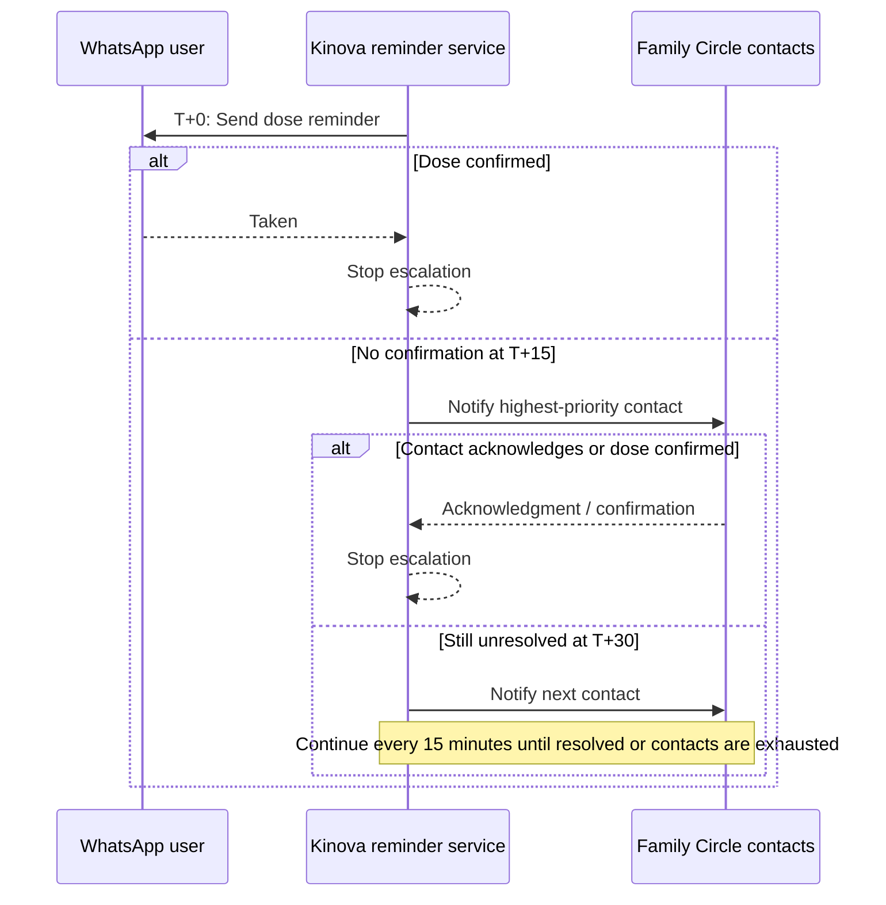
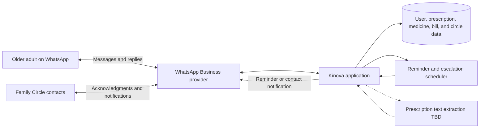

# Kinova

**A WhatsApp companion for medicine reminders, prescriptions, bills, and family follow-up.**

[](LICENSE)
[](#roadmap)
[](#tech-stack)

<!-- TODO: Replace placeholder badges once the license, CI workflow, and technology stack are confirmed. -->

## A little more support, right where it is familiar

Kinova is a proposed WhatsApp chatbot to help older adults keep up with prescriptions, medicine doses, and bills, without needing to learn a separate app. When a dose goes unconfirmed, a role-ordered Family Circle can be alerted in stages so a relative or other trusted contact can follow up.

### Demo / Screenshots

<!-- TODO: Add a short demo GIF showing a medicine reminder, a simple reply, and the Family Circle escalation. Add screenshots of bill tracking and an example Family Circle setup when available. Use fictional names and data. -->

*Demo and screenshots coming soon.*

## The Problem and Our Solution

It can be hard to keep track of doses, prescriptions, and bills, especially when an app requires a new download, account, and unfamiliar navigation. Older adults already use WhatsApp, so Kinova aims to make routine reminders and follow-up feel simpler and more familiar.

Kinova keeps the intended user interaction inside WhatsApp and can bring trusted family members into the follow-up when a dose is not confirmed. The repository currently contains no application implementation; the product description below records the intended scope, not a claim that the features are available today.

## Key Features

- **Prescription tracking:** Send a prescription as a photo or text; the intended system extracts medicine names, dosage, and duration. Extraction technology and availability are TBD.
- **Medicine reminders:** Receive scheduled WhatsApp messages with simple actions such as **Taken**, **Snooze**, or **Skip**.
- **Bill monitoring:** Keep track of bills, due dates, and payment status, with reminders before a due date.
- **No separate app for the older adult:** The intended user experience takes place in WhatsApp.
- **Family Circle escalation:** A user assigns trusted contacts roles and priorities. If a dose remains unconfirmed, contacts are notified in order at 15-minute intervals; escalation stops when the dose is confirmed or someone acknowledges.
- **Elderly-first interaction:** Use plain language, short messages, and minimal steps. Large-text-friendly message design is a goal; regional language support is planned for consideration.

<!-- TODO: Confirm which product features are implemented before describing them as available. -->

## How the Escalation Works

Contacts are ordered by the priority configured for the Family Circle. The example below assumes one contact is notified at each step and that no one responds. Exact acknowledgment behavior and whether an acknowledgment alone stops escalation need to be confirmed in the implementation.

| Time | What happens |
| --- | --- |
| **T+0** | Kinova sends the medicine reminder to the user. |
| **T+15 minutes** | If the dose is still unconfirmed, notify the first contact in the Family Circle (for example, the Primary Caregiver). |
| **T+30 minutes** | If there is still no confirmation or acknowledgment, notify the next contact in priority order (for example, the Nearest Relative). |
| **T+45 minutes** | If still unresolved, notify the next contact (for example, a Family Member). |
| **Next 15-minute intervals** | Continue through the configured circle while the dose remains unconfirmed. |
| **At any point** | Stop further escalation when the dose is confirmed or a contact acknowledges, as specified by the escalation policy. |



<!-- TODO: Define retry limits, time zone handling, contact exhaustion behavior, and whether acknowledgment without dose confirmation stops the sequence. -->

## Sample WhatsApp Conversation

The following is an illustrative example, not a transcript from a deployed bot. Contact names and medicine details are fictional.

```text
Kinova: Good morning, Maya. It's time for your 8:00 AM medicine.
         [Taken] [Snooze] [Skip]

Maya:    Taken

Kinova:  Thank you, Maya. I've marked this dose as taken.

          ... Another day: no response to the reminder ...

Kinova:  Dose not confirmed yet. I've let Ravi, your Primary Caregiver,
         know so they can check in.

Kinova:  Still not confirmed after 15 minutes. I've now notified Leela,
         the next contact in your Family Circle.
```

<!-- TODO: Confirm supported WhatsApp interactive message types and replace illustrative replies with implemented wording. -->

## System Architecture

This diagram describes a **conceptual architecture** for the product. The components and integrations have not been verified in this repository.



| Component | Responsibility |
| --- | --- |
| WhatsApp Business provider | Delivers messages and receives replies. Provider is TBD. |
| Kinova application | Applies product rules for reminders, replies, bills, and Family Circle escalation. Implementation is TBD. |
| Data store | Would hold the minimum data needed for user preferences, schedules, bills, and Family Circle configuration. Database and data model are TBD. |
| Reminder and escalation scheduler | Would send reminders and advance unresolved alerts on the configured schedule. Scheduler or queue is TBD. |
| Prescription extraction | OCR/LLM approach is TBD; extraction must be reviewed by the user and must not be presented as medical advice. |

## Tech Stack

The repository does not yet identify a runtime or dependencies. The values below are intentionally marked TBD rather than guessed.

| Area | Technology |
| --- | --- |
| Language and framework | TBD |
| WhatsApp integration | TBD — WhatsApp Business Cloud API, Twilio, or another provider |
| Database | TBD |
| Scheduler / queue | TBD |
| Prescription OCR / extraction | TBD |
| Hosting | TBD |
| Testing and CI | TBD |

<!-- TODO: Update this table after selecting the implementation stack and integrations. -->

## Getting Started

### Prerequisites

The application prerequisites cannot be specified until a runtime, provider, database, and scheduler are selected.

- Git
- <!-- TODO: Add runtime and version, database, and local services required by the implementation. -->
- <!-- TODO: Add a WhatsApp Business provider account and test setup requirements. -->

### Installation

Clone the repository:

```bash
git clone https://github.com/SurenDotCode/Kinova.git
cd Kinova
```

There is currently no application code or dependency manifest in the repository, so an install command is not available yet.

<!-- TODO: Add exact dependency installation commands when the project stack is in place. -->

### Environment Variables

No environment-variable names are defined in the current repository. These are configuration areas to document when implementation begins—not names to assume are already supported.

| Variable / setting | Description | Required |
| --- | --- | --- |
| TODO: WhatsApp provider credentials | Provider access token and related credentials; use secrets management and never commit real values. | TBD |
| TODO: Webhook verification | Secret or verification value for validating provider callbacks. | TBD |
| TODO: Database connection | Connection settings for the selected data store. | TBD |
| TODO: Scheduler configuration | Queue, scheduler, or worker settings. | TBD |
| TODO: Application environment | Local or deployed runtime mode and port, if applicable. | TBD |

<!-- TODO: Replace this table with the actual variable names, safe example values, and validation rules. -->

### WhatsApp Business API Setup

The provider has not been selected, so these steps are provider-neutral:

1. Choose a WhatsApp Business integration provider and create its development/test setup.
2. Configure a test sender and permitted recipient numbers according to that provider's instructions.
3. Configure the provider's inbound-message webhook to reach the Kinova application.
4. Verify webhook requests and store provider credentials as environment secrets.
5. Configure and obtain approval for any message templates required by the provider.
6. Send a test reminder and verify that replies reach the application.

<!-- TODO: Replace these general steps with provider-specific setup, webhook URLs, and template requirements. -->

### Running Locally

Local run instructions are not available until the application runtime, services, and configuration are implemented.

<!-- TODO: Add the exact command to start the application and any required worker/scheduler processes. -->

### How to Test

No test suite or test command is present in the repository yet.

<!-- TODO: Add commands for unit/integration tests and a safe test flow using provider test numbers and fictional health data. -->

## Project Structure

Current repository contents:

```text
Kinova/
└── README.md    Product overview and project documentation
```

<!-- TODO: Update this tree as application source, tests, and configuration are added. -->

## Usage / Bot Commands

The intended interaction is through ordinary WhatsApp messages and simple reply actions; no command syntax is implemented or documented yet.

Illustrative actions from the product scope:

| Action | Intended behavior |
| --- | --- |
| **Taken** | Confirm that a dose was taken and stop its escalation. |
| **Snooze** | Defer a reminder; snooze duration and behavior are TBD. |
| **Skip** | Record that the user skipped a dose; follow-up behavior is TBD. |
| Send prescription photo or text | Submit prescription details for extraction; technology, confirmation flow, and availability are TBD. |
| Add or update a bill | Track a bill, due date, and payment status; exact interaction is TBD. |
| Set up a Family Circle | Add trusted contacts and assign roles and priorities; exact interaction is TBD. |

<!-- TODO: Document only commands and actions that are implemented and tested. -->

## Roadmap

Implementation status cannot be confirmed from this repository, which currently contains only this README.

### Done

- No completed product features have been verified.

### In progress

- No in-progress implementation has been verified.

### Planned

- [ ] Select the application stack, WhatsApp provider, database, scheduler, and hosting.
- [ ] Define consent, account setup, and role/priority configuration for Family Circles.
- [ ] Implement prescription intake and a user review/confirmation flow.
- [ ] Implement scheduled medicine reminders and Taken / Snooze / Skip interactions.
- [ ] Implement bill tracking and due-date reminders.
- [ ] Implement ordered 15-minute Family Circle escalation and its stop conditions.
- [ ] Add tests, provider setup documentation, and deployment guidance.
- [ ] Evaluate regional language support and accessible message design.

<!-- TODO: Reconcile this roadmap with actual project progress. -->

## Privacy, Security and Disclaimer

Prescription, medicine, bill, and contact information can be sensitive. The implementation must explain what data it collects and why, obtain appropriate permission, limit access, and provide a way to correct or delete data. Do not send real health information while using an unverified development setup.

- **Family Circle consent:** Obtain each contact's consent before adding them or sending them alerts. Make the role, expected notifications, and removal process clear.
- **Encryption and access:** Use encrypted transport and protect stored data and credentials. Encryption at rest, access controls, and key management must be selected and verified; this README does not claim they are implemented.
- **Data retention:** Define retention and deletion periods for prescriptions, reminders, bills, messages, and contact details before launch.
- **Compliance considerations:** Determine which privacy, health-data, messaging, and consumer-protection requirements apply in each deployment region. Obtain qualified legal and security review. No regulatory compliance is claimed here.
- **Health disclaimer:** Kinova is intended as a reminder and coordination tool. It is **not a substitute for medical advice, diagnosis, treatment, or emergency services**. Users should consult a qualified health professional about medicines and contact local emergency services in an emergency.

<!-- TODO: Publish the implemented privacy policy, security practices, retention schedule, and regional compliance review before handling real user data. -->

## Contributing

Contributions and thoughtful feedback are welcome. Since the implementation and development workflow are not yet present, please open an issue before submitting a substantial change so the project scope and technical direction can be discussed.

<!-- TODO: Add contribution guidelines, development setup, and pull request checks. -->

## License

License: **TBD**. No license file is present in this repository yet.

<!-- TODO: Choose a license and add its full text in LICENSE before distributing the project. -->

## Contact and Acknowledgements

- **Repository:** [SurenDotCode/Kinova](https://github.com/SurenDotCode/Kinova)
- **Contact:** <!-- TODO: Add a maintained contact channel or project discussion link. -->
- **Acknowledgements:** <!-- TODO: Credit contributors, libraries, and service providers when selected. -->
